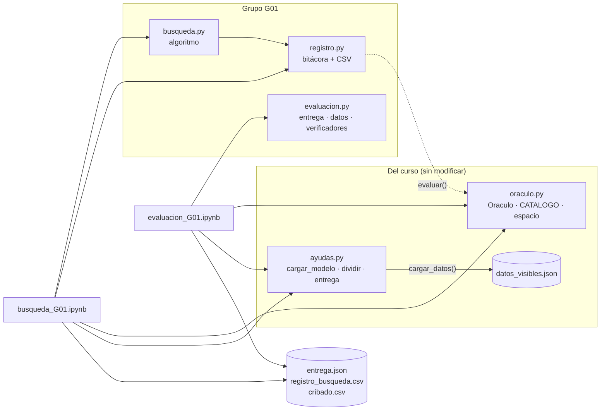

# Manual técnico · Solución base del Proyecto Oráculo · Grupo G01

**Análisis y Diseño de Algoritmos · Universidad de Caldas · 2026-2**
Autora: Jackeline Rivera Aguilera · Versión: rama `main`, primera entrega (semana 4)

## Contenido

1. [Propósito y alcance](#1-propósito-y-alcance)
2. [Entorno](#2-entorno)
3. [Arquitectura](#3-arquitectura)
4. [Funcionamiento](#4-funcionamiento)
5. [Formatos de entrada y salida](#5-formatos-de-entrada-y-salida)
6. [Uso paso a paso](#6-uso-paso-a-paso)
7. [Validación: pruebas disponibles](#7-validación-pruebas-disponibles)
8. [Limitaciones, errores conocidos y supuestos](#8-limitaciones-errores-conocidos-y-supuestos)
9. [Componentes aún no desarrollados](#9-componentes-aún-no-desarrollados)
10. [Referencias](#10-referencias)

---

## 1. Propósito y alcance

Este manual explica cómo está construida la solución base del Proyecto Oráculo y cómo reproducir su ejecución. La solución:

1. **busca** una configuración de prompt (un índice por ranura más la temperatura) consultando el oráculo del proporcionado sobre las 100 instancias de búsqueda;
2. **registra** cada configuración evaluada con su precisión, su costo y las familias de restricción que fallaron;
3. **valida** la configuración elegida con `oraculo.validar`;
4. **exporta** `entrega.json`;
5. ofrece un notebook de evaluación para que la configuración se califique sobre datos privados sin editar código.

La formalización del problema, la prueba de NP-dureza y la discusión de resultados están en el informe académico. Aquí solo se describe el software.

Para ver el informe académico, ver [`docs/Informe_Primera_Entrega_G01.pdf`](docs/Informe_Primera_Entrega_G01.pdf)
## 2. Entorno

| Elemento | Detalle |
|---|---|
| Lenguaje | Python 3: el del entorno de Google Colab para los notebooks. Los módulos propios solo usan la biblioteca estándar; las pruebas se verificaron con Python 3.13 |
| Plataforma de ejecución | Google Colab con GPU NVIDIA T4 (16 GB). `ayudas.cargar_modelo` se detiene si no hay GPU |
| Modelo | `Qwen/Qwen3-1.7B` en fp16 (≈ 3,4 GB de VRAM), modo de pensamiento apagado |
| Almacenamiento | Google Drive (`/content/drive/MyDrive/oraculo_G01/`) para el caché del oráculo y los registros |
| Dependencias (Colab) | Ver [`requirements.txt`](../requirements.txt): `transformers`, `accelerate`, `bitsandbytes`, `torch`, `nltk`, `spacy` (+ `en_core_web_sm`), `emoji`, `langdetect`, `immutabledict`, `absl-py`, `syllapy`, `pandas`, `matplotlib`, `tqdm` |
| Repositorios clonados | `allenai/open-instruct` (verificadores IFEvalG, los que usa `oraculo.py`) y `allenai/IFBench` en el commit `1c40f0c` (solo el notebook de evaluación) |
| Dependencias de las pruebas | `pytest` ([`requirements-dev.txt`](../requirements-dev.txt)). No requieren GPU, ni modelo, ni `torch` |
| Sistema para las pruebas locales | Cualquiera con Python 3.10 o superior (Linux, macOS, Windows) |

## 3. Arquitectura

### 3.1 Archivos y responsabilidades

| Archivo | Origen | Responsabilidad |
|---|---|---|
| `oraculo.py` | Curso (sin modificar) | Caja negra: arma el prompt, genera con el modelo, verifica las restricciones (todo o nada), cachea y devuelve `Resultado(precision, trazas, n)` |
| `ayudas.py` | Curso (sin modificar) | `cargar_modelo`, `cargar_datos`, `dividir`, `ver_prompt`, `curva`, `entrega` |
| `registro.py` | G01 | Clase `Registro`: envuelve al oráculo, anota cada evaluación (fase, configuración, precisión, consultas, generaciones nuevas, segundos, familias violadas) y exporta a CSV. Define `RANURAS` y `config_completa` |
| `busqueda.py` | G01 | El algoritmo: `cribado`, `podar`, `inicio_desde_cribado`, `ascenso`, `todas_las_opciones`, `probar_temperaturas`, `busqueda_aleatoria` |
| `evaluacion.py` | G01 | `cargar_entrega`/`validar_config`, `leer_instancias`/`normalizar`, `revisar_verificadores`, `verificar`/`blindar`, `resumen` |
| `busqueda_G01.ipynb` | G01 | Orquesta la búsqueda en Colab (versión sin salidas) |
| `busqueda_G01_resultado.ipynb` | G01 | La misma búsqueda ejecutada, con salidas e interpretación (evidencia) |
| `evaluacion_G01.ipynb` | G01 | Evalúa `entrega.json` sobre un archivo de prueba |
| `tests/test_busqueda.py`, `tests/test_evaluacion.py` | G01 | Pruebas con un oráculo simulado |

**Decisión de diseño.** Los tres módulos propios no importan `torch` ni `oraculo`: reciben el oráculo ya construido. Por eso se pueden probar en cualquier computador con un oráculo simulado que tiene la misma interfaz (`evaluar(config, instancias, semilla)` y un atributo `cache`). Las dependencias van en un solo sentido: `busqueda.py → registro.py`. Así no hay importaciones circulares y cada archivo tiene una sola responsabilidad: el algoritmo decide, el registro anota.

### 3.2 Diagrama de módulos



## 4. Funcionamiento

### 4.1 Flujo del notebook de búsqueda

1. **Instalación:** dependencias, clon de open-instruct y descarga de los archivos del repositorio desde `main`. Después se reinicia la sesión.
2. **Modelo:** `cargar_modelo("qwen17b")`.
3. **Oráculo:** `Oraculo(modelo, busqueda, validacion, cache=<Drive>, lote=16, presupuesto=32_000_000)` y `Registro(oraculo, busqueda, semilla=1)`.
4. **Fases 0 a 4** (sección 4.2), con impresión de cada evaluación.
5. **Registro completo y curvas:** tabla, `curva(historial)` y la mejor precisión contra las consultas acumuladas. Se guardan `registro_busqueda.csv` y `cribado.csv`.
6. **Fallos de la configuración elegida** y prompt completo de una instancia.
7. **Validación:** `oraculo.validar(config, n=None)` sobre las 87 instancias.
8. **Entrega:** `entrega(grupo="G01", config, semana=4)` y descarga.

### 4.2 Algoritmo

Notación: *m* = 5 ranuras, *k* = 8 opciones por ranura, *n* = 100 instancias de búsqueda, *c* = 3 candidatos que sobreviven por ranura, *P* = número de pasadas (máximo 3). Toda comparación usa las mismas 100 instancias con `semilla=1`, para que las precisiones sean comparables.

| Fase | Función | Qué hace | Criterio de decisión | Parada | Evaluaciones (≤) |
|---|---|---|---|---|---|
| 0 · Base | `cribado` (primera llamada) | Evalúa `{"temperatura": 0.0}`, sin ninguna instrucción | — | — | 1 |
| 1 · Cribado | `cribado` | Evalúa cada opción sola: el oráculo no pega texto para las ranuras ausentes. Calcula las roturas (instancias que la base acertaba y la opción tumba, con su familia) y los arreglos | — | Al recorrer las m·k opciones | m·k = 40 |
| Poda | `podar` | Ordena cada ranura por precisión (desempate: menos roturas) y conserva las *c* mejores | Las *c* primeras; las demás se descartan con sus familias rotas como motivo | — | 0 |
| 2 · Ascenso | `ascenso(..., candidatos)` | Parte de la mejor opción de cada ranura sola. Para cada ranura, en orden, prueba sus candidatos con las otras 4 fijas | Cambia solo si la precisión mejora estrictamente (mejor mejora dentro de la ranura) | Una pasada sin mejoras, o *P* = 3 | 1 + P·m·(c−1) = 31 |
| 3 · Verificación | `ascenso(..., todas_las_opciones)` | El mismo ascenso con las 8 opciones por ranura | Ídem | Ídem. Si converge, la configuración es un óptimo local 1-opt | P·m·(k−1) = 105 |
| 4 · Temperatura | `probar_temperaturas` | Evalúa τ ∈ {0.3, 0.7} con semillas {1, 2, 3} | Se cambia a τ > 0 solo si su precisión promedio supera estrictamente a la de τ = 0 | Al terminar | 6 |

**Terminación.** En las fases 2 y 3, cada cambio aumenta estrictamente la precisión, que solo toma n + 1 valores (0/n, 1/n, …, n/n). Por eso el ascenso no puede ciclar y termina siempre, además del tope de *P* pasadas.

**Costo en consultas al modelo** (una consulta es una instancia generada y verificada):

- Peor caso con los parámetros usados: n·[1 + m·k + P·m·(c−1) + P·m·(k−1) + 6] = 100·182 = 18 200 consultas. En notación asintótica: O(n·m·k·P), polinomial en m y k.
- Fuerza bruta: n·kᵐ = 100·32 768 = 3 276 800 consultas, exponencial en *m*.
- **Observado:** 103 evaluaciones = 10 300 consultas. Gracias al caché, en las fases 2 y 3 se repiten configuraciones sin costo.

El trabajo propio de Python es comparar conjuntos, contar familias es O(n) por evaluación y toma microsegundos. El tiempo lo domina por completo la generación del modelo: ≈ 180–220 s por evaluación de 100 instancias en una T4.

### 4.3 Estructuras de datos

| Estructura | Tipo | Contenido |
|---|---|---|
| Configuración | `dict` | `{"rol": int, "estrategia": int, "formato": int, "estilo": int, "cierre": int, "temperatura": float}`. En la fase 1 es parcial (solo una ranura) |
| Resultado del oráculo | `oraculo.Resultado` | `precision`, `trazas` (solo los fallos: `id`, `violo`, `salida`), `n`. `Registro` le agrega `fallidas` (`dict` id → familia) y `aciertos` (`set` de ids) |
| Caché del oráculo | `dict` → JSON en Drive | Clave `"<modelo>|<md5(config)[:8]>|<id instancia>|<semilla>"` → `[acierto, familia_violada, salida]` |
| Memo del registro | `dict` | Clave `json(config)|semilla` → `Resultado`. Evita anotar dos veces la misma consulta |
| Filas del registro | `list[dict]` | Una por evaluación: `n, fase, config, semilla, precision, aciertos, fallos, consultas, generaciones, segundos, familias (Counter), nota` |
| Tabla del cribado | `list[dict]` | Una por (ranura, opción): `precision, delta, roturas, arreglos, familias_rotas (Counter), ids_rotas` |
| Candidatos | `dict[str, list[int]]` | Ranura → opciones que sobreviven a la poda |

### 4.4 Notebook de evaluación

1. **Celda 1.** Si no existe la marca `/content/.g01_instalado`, instala las dependencias, clona open-instruct e IFBench, descarga los datos de NLTK, crea la marca y reinicia la sesión (`os.kill`). En todos los casos descarga de `main` los archivos `oraculo.py`, `ayudas.py`, `datos_visibles.json`, `evaluacion.py` y `entrega.json`.
2. **Celda 2.** `cargar_entrega` valida las llaves, que los índices sean enteros entre 0 y 7 y que la temperatura sea 0.0, 0.3 o 0.7.
3. **Celda 3.** Busca el archivo de prueba en `/content/` con los nombres `datos_privados`, `test_privado` o `datos_prueba` (`.json` o `.jsonl`). Si no lo encuentra, lo pide con `files.upload()`. Si se cancela, entra en modo demostración (partición de validación). Normaliza los dos formatos aceptados (sección 5.3) y calcula una huella MD5 del archivo para usar un caché propio.
4. **Celda 4.**
   - `revisar_verificadores` comprueba, sin generar texto, que cada restricción tenga verificador (IFEvalG primero, después IFBench) y que acepte sus parámetros. Las instancias que no se pueden calificar se informan.
   - Se carga el modelo y se construye el oráculo con el registro de IFBench.
   - `blindar` reemplaza el verificador del oráculo por uno equivalente que cuenta las respuestas vacías y las excepciones de un verificador como fallo, igual que el evaluador oficial de IFBench, en vez de detener la evaluación.
5. **Celda 5.** `oraculo.evaluar(config, instancias, semilla=1)`, resumen y archivos de salida.
6. **Celda 6.** Ejemplos de fallos y descarga.

## 5. Formatos de entrada y salida

### 5.1 `datos_visibles.json`: entrada de la búsqueda

Lista de 450 instancias:

```json
{
  "id": 309,
  "prompt": "… In your response, the letter o should appear less than 9 times. …",
  "pregunta": "…",
  "restriccion": "In your response, the letter o should …\tFinish your response with …",
  "familia": "letters:letter_counting2",
  "ids": ["letters:letter_counting2", "startend:end_checker", "detectable_format:title"],
  "kwargs": [{"letter": "o", "let_frequency": 9, "let_relation": "less than"},
             {"end_phrase": "Is there anything else I can help with?"}, {}],
  "split": "busqueda"
}
```

`split` vale `busqueda` (100), `validacion` (87) o `descartada` (263). `restriccion` trae las restricciones separadas por tabuladores: es el texto que `cierre 3` repite al final del prompt.

### 5.2 `entrega.json`: salida de la búsqueda, entrada de la evaluación

```json
{
 "grupo": "G01",
 "config": {"rol": 6, "estrategia": 6, "formato": 0, "estilo": 7, "cierre": 3, "temperatura": 0.0},
 "semana": 4
}
```

### 5.3 Archivo de prueba (entrada del notebook de evaluación)

JSON (una lista, o un objeto con la lista en `instancias`, `datos`, `data` o `test`) o JSONL (un objeto por línea). Se aceptan dos esquemas por instancia:

| Esquema | Campos |
|---|---|
| Del curso | `prompt`, `ids`, `kwargs`, `id` (opcionales: `restriccion`, `split`) |
| IFEval / IFBench | `prompt`, `instruction_id_list`, `kwargs`, `key` |

Reglas de normalización:
- En los `kwargs` se eliminan los valores `None`.
- Si hay `split`, se omiten las instancias `descartada`; si alguna está marcada `test` o `prueba`, se usan solo esas.
- Los `id` repetidos se renombran (`id#posición`), porque el caché usa el `id` como clave.

### 5.4 `registro_busqueda.csv`

Una fila por evaluación:

| Columna | Significado |
|---|---|
| `n` | Número de la evaluación (orden de ejecución) |
| `fase` | `0-base`, `1-cribado`, `2-ascenso`, `3-verificacion` o `4-temperatura` |
| `rol` … `cierre`, `temperatura` | Configuración evaluada (`–` = ranura ausente) |
| `semilla` | Semilla del muestreo (solo importa con τ > 0) |
| `precision`, `aciertos`, `fallos` | Resultado sobre las 100 instancias |
| `consultas` | Costo lógico: instancias consultadas (100) |
| `generaciones` | Consultas que se generaron de verdad en esa sesión (0 = salieron del caché) |
| `segundos` | Tiempo de esa llamada en esa sesión (≈ 0 si salió del caché) |
| `familias_mas_violadas` | Las 3 familias que más tumbaron instancias (primera restricción violada) |
| `nota` | Pasada y ranura en las fases 2 y 3, o semilla en la fase 4 |

`cribado.csv` tiene una fila por (ranura, opción) con `precision`, `delta` (frente a la base), `roturas` y `arreglos`.

### 5.5 Salidas del notebook de evaluación

- **`resultados_evaluacion_G01.json`:** grupo, semana, configuración, modo (`prueba` o `demostracion`), archivo y su huella, modelo, semilla, `precision` (sobre las instancias calificables), `aciertos`, `n_calificables`, `n_archivo`, `precision_archivo_completo` (las no calificables cuentan como fallo), `no_calificables`, `familias_que_mas_fallan` y `segundos`.
- **`resultados_evaluacion_G01.csv`:** una fila por instancia con `id`, `restricciones`, `acierto`, `violo` y `salida_inicio` (primeros 200 caracteres de la respuesta fallida).

## 6. Uso paso a paso

### 6.1 Reproducir la búsqueda

1. Abrir `busqueda_G01.ipynb` en Colab desde el enlace del README.
2. Entorno de ejecución ▸ Cambiar tipo de entorno de ejecución ▸ T4 GPU.
3. Ejecutar solo la celda 1 y esperar el mensaje `LISTO`. Luego Entorno de ejecución ▸ Reiniciar sesión.
4. Seleccionar la celda 2 y usar Entorno de ejecución ▸ Ejecutar las celdas posteriores Autorizar Google Drive en la celda 3.
5. Interpretar la salida. Cada evaluación imprime una línea así:
   ```
   [ 69] 3-verificacion rol=6 est=6 for=0 est=7 cie=3 T=0.0 precisión  21.0%   gen nuevas    0      0.0s  pasada 1, estrategia
   ```
   Se lee: número de evaluación, fase, configuración, precisión sobre las 100 instancias, cuántas respuestas se generaron (0 = caché), tiempo y nota.
   Ojo: en esta versión las etiquetas abreviadas de estrategia y estilo coinciden (`est=`). La primera `est=` es estrategia y la segunda es estilo.
6. Al final se descargan `entrega.json`, `registro_busqueda.csv` y `cribado.csv`.

**Si Colab se desconecta o se agota la GPU:** repetir los pasos 3 y 4. El caché en Drive conserva todo lo generado, y las configuraciones ya evaluadas aparecen con `gen nuevas 0`. No hay que editar nada. La GPU es obligatoria incluso cuando todo sale del caché, porque el notebook carga el modelo.

### 6.2 Evaluar `entrega.json` sobre datos privados

1. Abrir `evaluacion_G01.ipynb` en Colab con T4 GPU.
2. Ejecutar todo. La sesión se reinicia sola al terminar la instalación; el aviso de Colab es esperado.
3. Ejecutar todo otra vez.
4. Subir el archivo de prueba cuando se pida, o dejarlo antes en `/content/datos_privados.json(l)`.
5. Leer el resultado en la celda 5:
   ```
   Grupo G01 · PRUEBA
   Configuración: {'rol': 6, 'estrategia': 6, 'formato': 0, 'estilo': 7, 'cierre': 3, 'temperatura': 0.0}
   Precisión (instancias calificables): xx.x%  (aciertos/n)
   ```

**Ejemplo pequeño (modo demostración):** si en el paso 4 se cancela la subida, se evalúan las 87 instancias de validación. El resultado debe coincidir con la validación del notebook de búsqueda (18,4 %) o quedar muy cerca: puede diferir en alguna instancia (sección 8).

### 6.3 Ejecutar las pruebas

```bash
pip install -r requirements-dev.txt
python -m pytest -q tests/
```

## 7. Validación: pruebas disponibles

Las pruebas usan un oráculo simulado que sigue el modelo de compatibilidad del informe:
- cada instancia admite ciertas opciones por ranura y se acierta solo si todas las opciones elegidas son admisibles;
- algunas instancias solo se aciertan con el recordatorio de `cierre`.

| Prueba | Qué verifica |
|---|---|
| `test_registro_cuenta_generaciones_y_no_duplica` | El costo se cuenta bien y una consulta repetida no se anota dos veces; otra semilla sí cuenta como consulta nueva |
| `test_cribado_cuesta_1_mas_m_por_k` | El cribado hace exactamente 1 + m·k = 41 evaluaciones |
| `test_poda_nunca_vacia_una_ranura` | Quedan 3 candidatos por ranura y 25 descartes |
| `test_resultado_es_optimo_local_1opt` | Ninguna configuración que cambie una sola ranura supera a la devuelta |
| `test_encuentra_el_optimo_global_en_modelo_separable` | Sin interacciones entre ranuras, el resultado coincide con la bruta sobre las 32 768 configuraciones |
| `test_config_final_tiene_formato_de_entrega` | La salida respeta las restricciones del problema: 5 enteros en [0, 7] y una temperatura válida |
| `test_csv_se_escribe` | El CSV tiene una fila por evaluación |
| `test_cargar_entrega_valida`, `test_config_invalida` (5 casos), `test_config_sin_ranura` | Validación de `entrega.json`: índices fuera de rango, tipos incorrectos, temperatura no permitida y llaves faltantes |
| `test_entrega_del_repositorio_es_valida` | El `entrega.json` del repositorio es válido |
| `test_formato_del_curso_filtra_descartadas`, `test_formato_ifbench_jsonl_quita_none`, `test_ids_repetidos_se_renombran`, `test_split_test_tiene_prioridad`, `test_datos_visibles_del_repo_se_leen` | Lectura y normalización de los formatos de datos |
| `test_revisar_verificadores_detecta_familia_desconocida` | Las familias sin verificador y los parámetros inválidos se detectan antes de generar |
| `test_verificar_todo_o_nada_y_robusto` | Puntaje todo o nada; las respuestas vacías no detienen la evaluación |
| `test_resumen` | Conteos y tabla por instancia |

**Resultado esperado:** `23 passed`.

Además se verificó, fuera de las pruebas automáticas, que:
- con los verificadores reales, las 187 instancias visibles y las 300 de IFBench pasan `revisar_verificadores`;
- con solo IFEvalG, las 300 de IFBench fallarían, lo que justifica incluir IFBench;
- con respuestas vacías, `last_word:last_word_answer` y `sentence:increment` lanzan `IndexError`, y `verificar` lo maneja.

## 8. Limitaciones, errores conocidos y supuestos

**Supuestos**
- El modelo, el catálogo y los verificadores son fijos. Con τ = 0 la generación es greedy, así que el oráculo es determinista y el caché es exacto.
- Las 100 instancias de búsqueda representan la distribución de las de validación (el curso las preparó con la misma dificultad media).

**Limitaciones del método**
- **Óptimo local, no global.** El ascenso garantiza que ningún cambio de una sola ranura mejora el resultado, pero hay interacciones entre ranuras. Por ejemplo, `rol 6` sola daba 15 % y combinada da el mejor resultado. Un óptimo global exigiría el algoritmo exacto (sección 9).
- **Ruido de muestreo.** Con 100 instancias, el error estándar de una precisión cercana al 20 % es de unos ±4 puntos. Las diferencias de 1–2 puntos entre configuraciones no son concluyentes.
- **La poda puede equivocarse.** El cribado mide cada opción aislada. La fase 3 existe para corregirlo y en esta ejecución lo hizo: recuperó `rol 6`.
- **Recordatorio ausente en datos ocultos.** Si el archivo de prueba no trae el campo `restriccion` (como en el formato de IFBench), `cierre 3` no agrega texto y su ventaja puede desaparecer.

**Errores conocidos y limitaciones operativas**
- La cuota gratuita de GPU de Colab puede agotarse a mitad de la búsqueda. Mitigación: caché en Drive y reanudación sin pérdidas.
- Después de la instalación hay que reiniciar la sesión. El notebook de evaluación lo hace solo; el de búsqueda, como el del curso, lo pide.
- En la salida impresa de la búsqueda, `estrategia` y `estilo` comparten la etiqueta `est=` (sección 6.1). Los datos y el CSV no se ven afectados.
- En `registro_busqueda.csv`, `segundos` y `generaciones` describen la última sesión: las filas que salieron del caché muestran 0. Los tiempos reales (≈ 180 s en el cribado, ≈ 197 s en el ascenso, ≈ 211 s en la verificación y ≈ 221 s en la temperatura) salen de las sesiones en que se generaron.
- `oraculo.py` (del curso) puede detenerse si el modelo devuelve un texto vacío para una instancia con `last_word:last_word_answer`. No ocurrió en la búsqueda. El notebook de evaluación está protegido con `blindar`.
- El caché del oráculo identifica las instancias por `id`, no por su contenido. El notebook de evaluación usa un caché por archivo (huella MD5) para no mezclar datos.
- Al generar por lotes en fp16, el agrupamiento de prompts puede cambiar mínimamente alguna respuesta. Por eso la demostración puede diferir en alguna instancia de la validación.

## 9. Componentes aún no desarrollados

Esta es la solución base de la primera entrega. Faltan, según el cronograma del curso:

- **Algoritmo exacto:** backtracking con poda por cota superior, con la deducción formal de su T(n).
- **Successive Halving** (divide y vencerás por rondas) y su costo |C|·n₀·log₂|C|.
- **Comparación del reparto del presupuesto:** uniforme frente a adaptativo.
- **Variantes:** espacio extendido con temperatura como decisión, bandidos UCB1, recocido simulado o algoritmo genético.
- **Validación experimental:** generación de instancias sintéticas de tamaño creciente (al menos 5 tamaños), medición de tiempos y contraste con la T(n) teórica. El oráculo simulado de `tests/` es la base prevista para el generador.
- **Comparación con la búsqueda aleatoria** usando el mismo número de evaluaciones. Está implementada (`busqueda_aleatoria`, última celda del notebook), pero no se ejecutó por costo de GPU.

## 10. Referencias

Agrawal, L. A., Tan, S., Soylu, D., Ziems, N., Khare, R., Opsahl-Ong, K., Singhvi, A., Shandilya, H., Ryan, M. J., Jiang, M., Potts, C., Sen, K., Dimakis, A. G., Stoica, I., Klein, D., Zaharia, M., & Khattab, O. (2025). *GEPA: Reflective prompt evolution can outperform reinforcement learning* (arXiv:2507.19457). arXiv. https://arxiv.org/abs/2507.19457

Chang, Y., & Chen, X. (2026). *Naive prompt optimization: Rethinking the need for complex prompt search* (arXiv:2608.27266). arXiv. https://arxiv.org/abs/2608.27266

DanielMelo404. (2026). *Proyecto-Oraculo-AyD* [Repositorio de software]. GitHub. https://github.com/DanielMelo404/Proyecto-Oraculo-AyD

Pyatkin, V., Malik, S., Graf, V., Ivison, H., Huang, S., Dasigi, P., Lambert, N., & Hajishirzi, H. (2025). *Generalizing verifiable instruction following* (arXiv:2507.02833). arXiv. https://arxiv.org/abs/2507.02833
